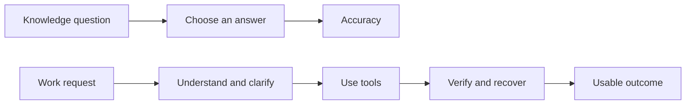
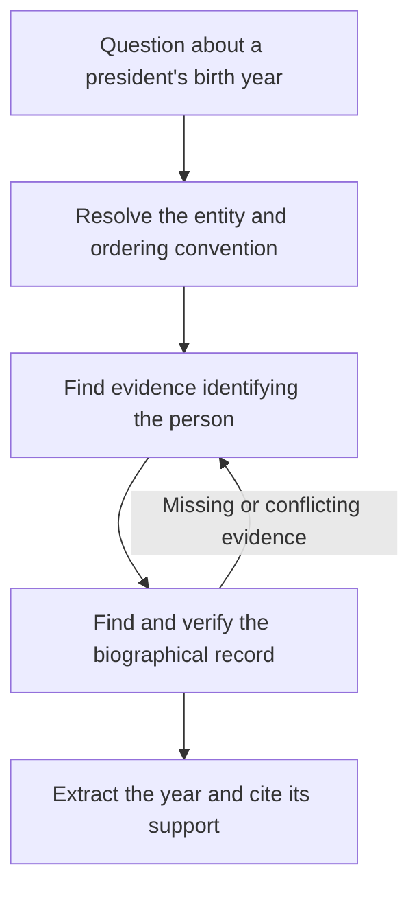
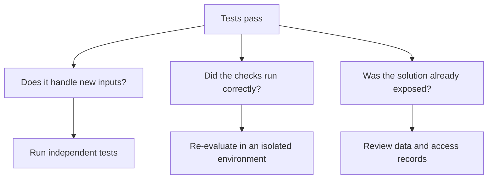
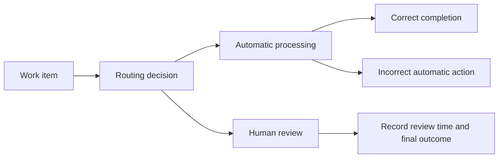

When a new model arrives, I usually look at its benchmark table first. There are scores for knowledge, coding, search, and tool use. It is tempting to assume that a few extra points will translate into better performance at work.

As I examined agent benchmarks more closely, I started separating two expectations: **understanding what a problem requires, and producing a justified answer.** In a tool-using system, finding and checking evidence connects the two. Which of these abilities does a benchmark score actually measure?

Choosing a correct answer, repairing a codebase, and completing a workflow through several tools require overlapping abilities. Each evaluation captures a different part of that picture. To interpret its results, we need to understand both its scope and its omissions.

## A simple score can summarize a difficult test

MMLU evaluates knowledge and problem solving across 57 subjects, including mathematics, history, computer science, and law. Its common format supports useful comparisons across subjects. [MMLU paper](https://arxiv.org/abs/2009.03300)

The simplicity I am concerned about is **compressing performance into a single accuracy figure**. The questions themselves can be difficult. Solving them matters, but that score does not directly measure whether a system clarifies an ambiguous request, recovers from a failed action, or recognizes when a person should take over.

> **In simple words - Benchmark:** A set of tasks and scoring rules used to compare systems. Understanding the tasks is essential to interpreting the score.
{: .notice--info}



*Conceptual diagram. Knowledge tests capture part of the ability needed for work. A workflow also requires execution and verification.*

## Understanding a question is different from recalling its answer

Consider asking someone unfamiliar with Korean history: "What year was the second president of South Korea born?" I would not expect instant recall. I would expect them to understand how to establish the answer.

They might identify the relevant presidential sequence, determine which person occupies the second position, find a reliable biographical record, and extract the birth year. The wording also matters: the second person to hold office and the holder of a second presidential term are different concepts. An evaluation should make the intended interpretation clear, or reward appropriate clarification.



*Illustrative task decomposition, not a record of an executed search. Equivalent valid routes should also receive credit.*

This is why I distinguish understanding the problem from answering it. For diagnosis, I would separate evidence acquisition as a third observable component: what must be established, where the supporting information comes from, and how the answer follows from it. Reasoning can contribute to all three. Extraction and summarization alone do not cover comparison, calculation, or resolving contradictions.

A correct year on its own cannot tell us whether the system remembered it, guessed it, or established it through evidence. For some applications, a correct remembered answer is enough. For an auditable research assistant, the supporting evidence is part of the deliverable. More tool calls do not automatically make an answer better.

Nor should we treat every retrieved page as ground truth. A benchmark may define a reference answer and trusted evidence, while the live web contains mistakes, outdated records, and conflicting claims. Choosing which sources to trust is itself an evaluation target.

## Which benchmarks already address this distinction?

It would be too broad to say that existing evaluations ignore retrieval and reasoning. Several were explicitly developed to study them. The remaining issue is whether the reported result makes individual strengths and failures visible.

| Benchmark | What it contributes to this discussion | What I would inspect beyond the headline score |
|---|---|---|
| MMLU | Broad subject knowledge and problem solving | Whether stored knowledge transfers to the intended workflow |
| MuSiQue | Connected multi-hop questions designed to reduce shortcuts | Supporting evidence, answerability, and sensitivity to missing information |
| FRAMES | Questions requiring factual retrieval and reasoning across multiple sources | Retrieval failures versus failures to use sufficient evidence |
| GAIA | Assistant tasks combining reasoning, browsing, tools, and sometimes multimodal inputs | Which dependency or tool interaction prevented completion |
| BrowseComp | Persistent search for hard-to-find information with short, checkable answers | Source support, search cost, and correctness under a fixed budget |
| AssistantBench | Realistic, time-consuming tasks on the web | Coverage of requested information and transfer between steps |
| AgentBoard | Analysis of multi-turn agents, including incremental progress | Partial completion and recovery alongside final success |

Sources: [MuSiQue](https://arxiv.org/abs/2108.00573), [FRAMES](https://arxiv.org/abs/2409.12941), [GAIA](https://arxiv.org/abs/2311.12983), [BrowseComp](https://arxiv.org/abs/2504.12516), [AssistantBench](https://arxiv.org/abs/2407.15711), and [AgentBoard](https://arxiv.org/abs/2401.13178). The final column contains proposed diagnostic questions, not a claim that every benchmark publishes these measurements.

## Separate finding evidence from using it

I would test the same questions under several controlled conditions:

| Condition | What the system receives | Diagnostic purpose |
|---|---|---|
| Closed book | Question only | Establish a baseline without external evidence |
| Reference evidence | Question plus sufficient verified evidence | Test whether the system can use the necessary information |
| Retrieved evidence | Question plus results from a fixed retrieval system | Examine the effect of imperfect retrieval |
| Agent search | Question and permission to search iteratively | Evaluate the complete evidence-gathering workflow |
| Missing or conflicting evidence | A controlled evidence packet with a gap or contradiction | Test appropriate uncertainty, clarification, or further search |

These conditions provide diagnostic comparisons rather than a perfect mathematical decomposition of capability. Context length, distracting information, and tool instructions can change behavior. In particular, success with reference evidence does not prove that every failure with retrieved evidence belongs to the retriever.

I would record final correctness, coverage of required evidence, whether citations support the claims, appropriate abstention, latency, and cost. For a controlled evidence-use test, missing support should trigger uncertainty even if the model remembers a plausible answer; that requirement must be explicit in the task.

To investigate generalization, vary entities, wording, distractors, and required combinations while preserving task structure. Controlled fictional records can help test whether a model follows supplied evidence instead of recalling a familiar answer. Such tasks should be labeled synthetic and paired with realistic tasks.

This approach evaluates observable outcomes and evidence use. It does not require a model to reveal a private reasoning trace or imitate one preferred sequence of steps. A convincing explanation alone is not proof that the answer was derived correctly.

## Coding benchmarks ask different questions

SWE-bench evaluates patches that resolve issues in existing repositories. Verified is a subset selected through human review. SWE-bench Pro is a separately developed benchmark focused on complex repositories and substantial changes that can require extended work. [SWE-bench](https://www.swebench.com/), [SWE-bench Pro](https://labs.scale.com/papers/swe_bench_pro)

ProgramBench starts from a different position. An agent receives an executable and documentation, without the original source, and builds a program that reproduces its behavior. Evaluation compares the submitted program against the original. [ProgramBench](https://programbench.com/)

| Evaluation | Main question | Additional checks for deployment |
|---|---|---|
| SWE-bench | Can it resolve an issue in existing code? | Independent tests, regressions, review effort |
| SWE-bench Pro | Can it complete a complex change? | Change scope, environment, budget, version, extended execution failures |
| ProgramBench | Can it investigate behavior and implement a program? | Feature completeness, maintainability, runtime performance |

The final column contains checks I would add when selecting a system for work. These are not necessarily metrics each benchmark already reports. Scores from different tests are not interchangeable percentages of software engineering ability.

## Passing tests leaves questions unanswered

Suppose a function that calculates a mean has only these two tests. This is a hypothetical example.

```python
assert mean([1, 2, 3]) == 2
assert mean([2, 4, 6]) == 4
```

This implementation passes both:

```python
def mean(values):
    return values[1]
```

Yet it returns 2 for `[1, 2, 9]`, whose mean is 4. The implementation satisfies the examples while failing the requirement.

Such failures do not automatically imply deliberate cheating. A patch may reflect incomplete understanding, or the tests may provide insufficient coverage. Manipulating the grading process to obtain a reward is a separate concern. ImpossibleBench investigates test exploitation through tasks whose specifications conflict with their tests. [ImpossibleBench paper](https://arxiv.org/abs/2510.20270)

> **In simple words - Reward hacking:** Exploiting a scoring rule to earn a high reward without accomplishing the intended task.
{: .notice--info}



*Conceptual diagram. A passing result leaves questions about generalization, grading integrity, and exposure to the solution.*

## Different workflows have different failure costs

An awkward sentence in a summary and an incorrectly extracted account identifier should not carry the same weight. Neither should a slow search response and an incorrect account update by a customer-service agent.

I would prioritize the following metrics by workflow. This is a proposed evaluation framework, rather than a description of what every public benchmark measures.

| Workflow | Priority metric | Companion metrics |
|---|---|---|
| Knowledge questions | Accuracy by subject | Unsupported answers, uncertainty calibration |
| Code changes | Fraction of tasks passing independent verification | Regressions, review time, cost per task |
| Search and research | Answer correctness and supporting evidence | Missing information, source quality, research time |
| Customer service and tool use | Reaching the goal state while following policy | Incorrect state changes, repeated success, appropriate escalation |
| Document extraction | Exact match on critical fields | Whole-document success, incorrect automatic processing, review workload |
| Graphical interface use | Correct final state | Irreversible mistakes, recovery rate, latency |
| Extended workflows | Fraction of fully verified deliverables | Human intervention time, rework, cumulative cost |

Exact match checks whether a prediction and reference are identical after any explicitly defined normalization. It matters when a single incorrect digit makes an extracted value unusable downstream. For free-form explanations with several equally valid phrasings, exact match alone is insufficient.

## Succeeding once and succeeding consistently

Some tasks allow multiple attempts and human selection among candidates. Other workflows need a dependable result each time a user makes a request.

The distinction appears in `pass@k` and `pass^k`. The former asks whether at least one of k attempts succeeds; the latter asks whether all k succeed. The tau-bench paper introduced `pass^k` to measure repeated reliability in environments involving tools, policies, and user conversations. [Tau-bench paper](https://arxiv.org/abs/2406.12045)

> **In simple words - Reliability:** How consistently a system produces the correct outcome when used repeatedly under comparable conditions.
{: .notice--info}

For illustration, assume each attempt succeeds with probability 0.8 and attempts are independent. The probability of at least one success in five attempts is approximately 99.97%. The probability that all five succeed is approximately 32.77%.

```python
p, k = 0.8, 5
print(f"At least one success: {1 - (1 - p) ** k:.2%}")
print(f"Every attempt succeeds: {p ** k:.2%}")
```

These are illustrative probabilities, not measured benchmark results. Real tasks differ in difficulty, and failures can be correlated. Raising an aggregate success rate to a power is not a substitute for measuring repeated performance on individual tasks. Selecting the correct candidate also has a cost and may require a verifier unavailable in deployment.

## Put automation rate beside error rate

Optimizing automation rate alone can encourage a system to process ambiguous requests. Sending every request to a person avoids automatic processing errors but eliminates much of the potential labor saving.



*Conceptual diagram. Measure the benefit of automation alongside the cost of processing something incorrectly.*

For document extraction, I would report the fraction processed automatically together with the error rate among those automatically processed documents. Human review time and total completion time add a clearer picture of the workflow.

A curve showing how these rates change with the routing threshold can make the tradeoff visible. That curve needs measured data; a plausible-looking curve should not stand in for an experiment.

## Evaluate the system you will deploy

An agent's results depend on its model, prompts, tools, retrieval, memory, retries, and budget. Comparisons should either hold these conditions constant or document the differences.

At minimum, I would record:

- Dataset version, evaluation split, and run date.
- Model and agent code versions, plus permitted tools.
- Per-task time, token, and tool-call budgets, including retries.
- Success criteria, failure categories, and rules for human intervention.
- Results by domain and uncertainty across repeated runs, alongside the overall score.

Public benchmarks can help narrow the candidate list. A separate evaluation set drawn from the intended workflow can then test whether the choice holds up in practice. That set should include ambiguous requests, incomplete inputs, tool failures, and cases that should be escalated, alongside routine tasks. If development repeatedly uses that evaluation set, a separate final holdout is needed.

## What I want a benchmark table to tell me

Benchmarks provide common tasks through which we can compare methods and discuss progress. Their aggregate scores only partially describe how a system will help people do their work.

For coding, I want verified fixes and regression checks. For research, I want evidence and coverage. For tasks that change external state, I want error rates and repeated reliability. Human involvement should be measured through time and outcomes, as well as intervention counts.

The evaluation I want explains **what work was completed, under which conditions, how reliably, and how much work remained for a person**. The right metrics for each domain follow from those questions.

## Appendix: What changes when the evidence is visual?

The same questions extend to vision: what is the user asking about, what visual evidence matters, and what output would satisfy the request?

Classification and detection often have explicit output contracts, such as class labels or bounding boxes. A vision-language model can support a much broader range of requests. "Describe this room" admits many valid answers, while "Read the number on this sign" may have a precise reference answer. The openness of the task matters more than the model family alone. Classification and detection are semantic perception tasks, not simply lower rungs on a universal intelligence ladder.

VQA evaluation already acknowledges variation among human answers through consensus-based scoring. That helps with answer variation, although it does not resolve every question about user intent or visual grounding. [Official VQA evaluation](https://visualqa.org/evaluation.html)

| Visual task | Useful evidence of success | What can remain unmeasured |
|---|---|---|
| Classification or detection | Correct labels and localization | Robustness outside the annotated distribution |
| Visual question answering | A supported answer to the specific question | Whether language priors substituted for image evidence |
| Image or video generation | Requested attributes, spatial relations, and temporal consistency | Whether visual appeal conceals instruction failures |
| Vision-language-action | Correct goal state after execution | Safety, recovery, and transfer to changed environments |
| World modeling for planning | Accurate action-conditioned predictions and better downstream decisions | Error accumulation and behavior on unfamiliar situations |

This table proposes evaluation priorities; it does not claim that one metric covers every task in each row.

An action task can make the outcome more concrete. "Place the red object in the drawer" supplies an observable goal. But success also depends on initial conditions, physical execution, and acceptable side effects. LIBERO provides one established setting for studying robot manipulation and knowledge transfer. A benchmark success rate still needs to be interpreted within its environment. [LIBERO paper](https://arxiv.org/abs/2306.03310)

I would also separate representation from controllability. Language tokens, image patches, latent representations, pixels, and action vectors are ways to encode information. None guarantees that a user can reliably control the intended semantic change. Changing one phrase in a prompt may alter several visual attributes; changing a word in a text request can likewise have unintended effects. Controlled edits and tests of what should remain unchanged are useful in both cases.

This suggests a possible connection to world models: if a system predicts how a situation changes after an action, evaluation can examine whether those predictions support better decisions. That is a research hypothesis motivating this appendix, not an established explanation for current research trends. Attractive video alone would not demonstrate an accurate model of action consequences.

Similarly, the availability of image and video data does not by itself establish why generative modeling is an active area. Training targets, compute, applications, and evaluation all matter. The main argument remains about language-model evaluation: identify the intended task, then measure the abilities and failure modes that determine whether its result is useful.

---

*This article develops a perspective from public sources and discussion. It does not report benchmark runs performed for this article. The diagrams, proposed evaluation conditions, and probability example are explanatory, and the benchmark selection is not exhaustive.*
